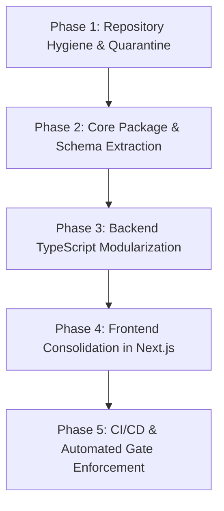

# Acharya Engineering Guardrails & Architectural Standards

> **Status:** Active & Mandatory  
> **Applies to:** Entire Repository (`apps/*`, `packages/*`, tooling, CI/CD, and deployments)  
> **Goal:** Eliminate architectural debt, enforce 100% type safety, decouple API from static serving, purge repository bloat (PDFs/loose assets), and guarantee production-ready deployments.

---

## 1. Core Architectural Tenets

1. **Zero Monolith / Hybrid Drift:** No hybrid JS/TS coexistence in application logic. Every piece of business logic, route handler, and data access layer must be written in strict TypeScript.
2. **Pure Separation of Concerns (API vs. Presentation):**
   - The backend server is **strictly a headless API** (JSON/SSE/WebSocket). It **never** serves HTML shells, CSS files, client JavaScript, or node_modules directly.
   - The frontend application (`apps/web`) handles all UI, routing, SSR/client bundling, and static UI assets.
3. **The "Dist-Only" Deployment Mandate:**
   - The production server receives **only compiled distribution artifacts (`dist/` or `.next/standalone`)** and external vendor runtime dependencies.
   - The `packages/` directory is **never uploaded or deployed to production servers**.
   - Build tools must bundle, in-line, or trace shared workspace packages into the output artifact so that the deployable application operates with **zero runtime dependence** on the monorepo root or sibling `packages/` folders.
4. **Zero Platform-Specific Hacks:**
   - Never rely on deployment platform settings (e.g. Vercel root directory toggles, custom symlinks, or container path gymnastics) to resolve monorepo packages.
   - Build tools must resolve and bundle internal dependencies natively at compile time via standard tool configurations (`transpilePackages`, `tsup`/`esbuild` bundling).
5. **Source Control Hygiene:**
   - **Zero large binary files in Git:** No raw PDFs, audio, video, or transformer model caches in Git history or worktrees.
   - All external learning materials, raw textbooks, and user-uploaded media live in object storage (AWS S3, Cloudflare R2, or GCP Cloud Storage).
6. **Fail Fast & Fail Closed:**
   - The server must refuse to boot if environment variables fail validation or if security secrets match insecure defaults.
   - Authorization gates must fail closed: on any error or missing session, access is denied (no fallback to "allow all").
7. **Contract-Driven Development:** Shared types and Zod validation schemas across frontend and backend packages serve as the single source of truth.

---

## 2. Target Monorepo Architecture & Workspace Boundaries

The repository must follow a clean **npm/pnpm workspaces** topology. No code or static assets live directly in the repository root.

```
acharya/
├── .github/
│   └── workflows/              # CI/CD pipelines (typecheck, lint, test, docker-build)
├── apps/
│   ├── api/                    # Headless Node.js/TypeScript backend (Express or Fastify)
│   │   ├── src/
│   │   │   ├── config/         # Validated environment configuration (Zod)
│   │   │   ├── modules/        # Feature modules (auth, content, practice, ai-tutor, xp)
│   │   │   │   ├── [feature]/  # Controller, Service, Repository, DTO/Schema, Routes
│   │   │   ├── middleware/     # Auth, Rate-limit, Error-handler, Correlation ID
│   │   │   └── server.ts       # App entry & graceful shutdown handlers
│   │   ├── Dockerfile          # Multi-stage production Docker build
│   │   ├── package.json
│   │   └── tsconfig.json
│   │
│   └── web/                    # Next.js 16 (React 19, Tailwind v4, Zustand, TanStack Query)
│       ├── public/             # Public UI assets ONLY (SVGs, logos, favicons)
│       ├── src/
│       │   ├── app/            # Next.js App Router (pages & layouts)
│       │   ├── components/     # UI primitives & interactive math tools
│       │   │   └── tools/      # React-migrated interactive math widgets (former src/tools)
│       │   ├── hooks/          # Client hooks
│       │   └── stores/         # Zustand state stores
│       ├── package.json
│       └── tsconfig.json
│
├── docs/                       # Centralized Project Documentation
│   ├── README.md               # Master documentation index
│   ├── architecture/           # System design, audits, playbooks & technical standards
│   ├── deployment/             # Containerization, env vars, ops, runbooks & remediation
│   └── requirements/           # Design requirements & checklists
│
├── tools/                      # Offline developer tooling, ingest & ETL scripts
│
├── .dockerignore
├── .gitignore
├── .prettierrc
├── eslint.config.mjs
├── package.json                # Root workspace configuration
```

### Boundary Rules
| Directory | Allowed Responsibilities | Forbidden Responsibilities |
|---|---|---|
| `apps/api` | Business logic, DB operations, auth, REST/RPC endpoints, LLM orchestration. | Serving static files, bundling frontend code, storing uploaded files on local disk. |
| `apps/web` | UI rendering, client-side caching, user interaction, routing. | Direct database connections, storing persistent server secrets. |
| `packages/core` | Pure algorithmic logic (quiz engine, XP), math helpers, Zod schemas, domain types. | Importing `express`, `fs`, `pg`, `react`, or any framework APIs. |
| `packages/db` | Table definitions, migrations, seed data, database query helpers. | HTTP handling, UI code. |
| `docs/` | Centralized documentation categorized into `architecture/`, `deployment/`, and `requirement/`. | Code files, node runtime scripts, or storing production assets. |
| Root (`/`) | Workspace configuration, CI workflows, global linting, `README.md`, `GUARDRAILS.md`. | Source code files, PDF files (`gegp*`), ad-hoc `.html` files, runtime scripts, loose documentation files. |

---

### 2.1 Documentation Taxonomy & Hygiene Guardrails
All technical, operational, and product documentation must be stored inside the `docs/` directory and categorized into one of three standardized subdirectories:

1. **`docs/architecture/` (Technical Design & Engineering Standards):**
   - High-level system design documents, component diagrams, and C4 models.
   - Architectural Decision Records (ADRs) and technical evaluation notes.
   - Technical audits, security reviews, and authoring engine playbooks (e.g. `AUDIT.md`, `LMS-PRODUCT-AUDIT.md`, `ACHARYA-PLAYBOOK.md`).
2. **`docs/deployment/` (Operations, Infrastructure & Runbooks):**
   - Containerization standards, multi-stage Docker configurations, and orchestrator manifests.
   - Environment variable specifications, secrets management protocols, and network topologies.
   - Production operations runbooks, disaster recovery plans, and remediation plans (e.g. `DEPLOYMENT.md`, `REMEDIATION-PLAN.md`).
3. **`docs/requirement/` (Product, Curriculum & Design Specifications):**
   - Curriculum mappings, chapter lists, and concept breakdowns (e.g. `math-chapters-class-7-and-8.md`, `math-concepts-class-7-and-8.md`).
   - Feature requirements, lesson flow specs, and design template requirements (e.g. `class7-math-template-spec.md`, `class7-math-build-plan.md`).
   - UI acceptance checklists, pattern selection matrices, and visual style catalogs.
   - Prototype and exploratory HTML mockups (e.g. `docs/requirement/prototypes/`).

> [!IMPORTANT]
> **Zero Loose Documentation at Repository Root:**  
> Dumping markdown specs, audit reports, or HTML prototypes directly into the repository root is strictly prohibited. The root is reserved exclusively for `README.md` (project overview) and `GUARDRAILS.md`. All other project knowledge must be filed into `docs/architecture/`, `docs/deployment/`, or `docs/requirement/`.

---

## 3. Strict TypeScript Standards

### 3.1 Compiler Configuration (`tsconfig.json`)
All workspace packages must inherit from a shared base configuration with strict checking enabled:

```json
{
  "compilerOptions": {
    "target": "ES2022",
    "module": "NodeNext",
    "moduleResolution": "NodeNext",
    "lib": ["ES2022"],
    "strict": true,
    "noImplicitAny": true,
    "strictNullChecks": true,
    "strictFunctionTypes": true,
    "strictBindCallApply": true,
    "strictPropertyInitialization": true,
    "noImplicitThis": true,
    "alwaysStrict": true,
    "noUnusedLocals": true,
    "noUnusedParameters": true,
    "noImplicitReturns": true,
    "noFallthroughCasesInSwitch": true,
    "noUncheckedIndexedAccess": true,
    "exactOptionalPropertyTypes": true,
    "forceConsistentCasingInFileNames": true,
    "skipLibCheck": true,
    "esModuleInterop": true
  }
}
```

### 3.2 Typing Rules
1. **No `any` Ever:** The use of `any` is prohibited. If the type is genuinely unknown (e.g., third-party API payloads, untrusted input), use `unknown` and narrow with type guards or parse using Zod.
2. **Runtime Validation at I/O Boundaries:**
   - Every incoming HTTP request (body, params, query) must be parsed through a Zod schema before hitting service logic.
   - Every external service response (LLM API, Hugging Face, third-party auth) must be parsed via Zod.
   - Infer TypeScript types directly from schemas:
     ```ts
     import { z } from "zod";

     export const CreateQuestionSchema = z.object({
       prompt: z.string().min(5),
       difficulty: z.enum(["easy", "medium", "hard"]),
       options: z.array(z.string()).min(2),
       answer: z.string(),
     });

     export type CreateQuestionDto = z.infer<typeof CreateQuestionSchema>;
     ```
3. **Strict Return Types:** All exported functions, service methods, and API handlers must declare explicit return types. Do not rely on loose compiler inference for public boundaries.
4. **No Type Assertions (`as SomeType`):** Type assertions silence the compiler and introduce runtime crashes. Use type guards (`is`) or Zod schema validation instead.

---

## 4. Code Quality, Linting & Formatting Guardrails

### 4.1 Tooling Stack
- **ESLint 9+ (Flat Config):** Enforces TypeScript, imports, security, and React rules.
- **Prettier:** Code formatting source of truth (single quotes, trailing commas, 2-space indentation).
- **Husky & lint-staged:** Runs pre-commit checks locally so broken code never reaches remote branches.
- **Commitlint:** Enforces Conventional Commits (`feat:`, `fix:`, `refactor:`, `chore:`, `test:`, `docs:`).

### 4.2 Automated Pre-Commit Pipeline (`lint-staged`)
Every commit must automatically execute:
```json
{
  "*.{ts,tsx}": [
    "eslint --fix --max-warnings=0",
    "prettier --write"
  ],
  "*.{json,md,yml,yaml}": [
    "prettier --write"
  ]
}
```
In addition, a pre-push hook must run `turbo run typecheck test` across all workspaces.

---

## 5. Package.json, Dependencies, Versioning & Scripts Guardrails

### 5.1 Root vs. Application `package.json` Separation
1. **Lean Root Mandate:**
   - The root `package.json` must contain **zero application runtime dependencies**.
   - Prohibited at root: `express`, `pg`, `bcryptjs`, `helmet`, `@huggingface/transformers`, etc. (Current debt: these currently sit in root `package.json`).
   - The root is strictly for monorepo orchestration: `"workspaces"`, `"devDependencies"` for repository-wide developer tooling (Turborepo, Husky, Prettier, ESLint), and high-level pipeline scripts.
2. **Dedicated App Manifests:**
   - Each app (`apps/web`, `apps/api`) and package (`packages/core`, `packages/db`) must manage its own independent `dependencies` and `devDependencies`.
   - Never install backend libraries (`pg`, `express`, `multer`) into frontend manifests, and never install frontend/DOM libraries (`katex`, `dompurify`, `react`) into backend manifests.

### 5.2 Dependency Hygiene, Versioning & Engine Constraints
1. **Explicit Engine Pinning:**
   - Every workspace `package.json` and root must explicitly pin supported Node and package manager engines:
     ```json
     "engines": {
       "node": ">=22.0.0",
       "npm": ">=10.0.0"
     }
     ```
2. **Version Pinning Strategy:**
   - **Production runtime dependencies:** Must use exact or strict tilde (`~`) ranges for critical infrastructure libraries (e.g., database drivers `pg`, cryptographic modules `bcryptjs`/`argon2`, session stores) to avoid unpredictable breaking changes during automated builds.
   - **Internal workspace packages:** Must use `"workspace:*"` (or `"*"` with npm workspaces) so they always resolve to the exact local monorepo source during local development and builds.
3. **Lockfile Discipline:**
   - All environments (CI, Docker, staging, production) must install strictly via `npm ci --frozen-lockfile` (or `pnpm install --frozen-lockfile`).
   - Editing lockfiles manually or ignoring lockfile diffs in pull requests is strictly prohibited.
   - Regular automated security audits (`npm audit --audit-level=high`) must run as a gate in CI.

### 5.3 Scripts Architecture: Single Responsibility (No Overloaded Scripts)
1. **Prohibition of Script Overloading:**
   - Do **not** chain disparate lifecycle commands into overloaded npm scripts using long chains of `&&`, `;`, or obscure flags.
   - Example of Bad (Overloaded):
     ```json
     "deploy": "npm run clean && npm run build && node migrate.js && node seed.js && node server/index.js"
     ```
     *Why this is prohibited:* If a step fails mid-pipeline, state is corrupted, errors are masked, and debugging becomes impossible.
2. **Standardized Single-Purpose Script Names:**
   Every package and app must expose standard, predictable scripts:
   - `build`: Compiles the TypeScript/Next.js code to its output directory (`dist/` or `.next/`). **No database side effects allowed.**
   - `dev`: Starts the local development server with hot-reload / watch mode.
   - `test`: Executes automated test suites.
   - `typecheck`: Runs `tsc --noEmit` without side effects.
   - `lint`: Runs linter checks.
   - `clean`: Removes `dist/`, `.next/`, `coverage/`, and build caches.
3. **Database Migrations & Content Seeds are Independent Tasks:**
   - Database migrations (`db:migrate`) and data seeding (`db:seed`) must be dedicated scripts invoked by deployment orchestrators or CI/CD pipelines, **never** executed automatically inside an application's startup script or `build` step.

### 5.4 The "Dist-Only" Standalone Deployment Mandate
> **Core Principle:** The `packages/` directory is **never uploaded, copied, or deployed to production servers.** Only compiled output (`dist/`) is deployed.

1. **Self-Contained Distribution Artifacts:**
   - When building the backend (`apps/api`), the build tool (e.g., `tsup` or `esbuild`) must **bundle all internal workspace packages (`@acharya/core`, `@acharya/db`) directly into the compiled output files**.
   - The final output in `apps/api/dist/` must be completely self-contained. It must **never** contain relative imports pointing outside its folder (e.g., `import "../../packages/core"` is forbidden in generated JavaScript).
2. **Zero Runtime Monorepo Dependency:**
   - Once `dist/` is generated, the entire `packages/` directory, `apps/web/`, `scripts/`, and root configuration files can be wiped without affecting the backend's ability to run.
   - On production servers or inside minimal production Docker images, the runtime command is simply:
     ```bash
     node apps/api/dist/server.js
     ```
     With only production `node_modules` present (or zero external dependencies if bundled with vendor inlining).

### 5.5 Build Tools & Workspace Resolution: Zero Platform-Hacking
> **Problem:** In monorepos, frontend deployments (like Vercel) often fail if `apps/web` imports from `../../packages/core`, prompting developers to tweak platform root directories or enable "Include source files outside root directory".  
> **Mandate:** The build tooling must resolve and bundle shared code natively at compile time so the app works on **any** standard host without platform-specific configuration workarounds.

#### Method A: Next.js Native Transpilation (Recommended for `apps/web`)
In `apps/web/next.config.ts`, declare internal workspace packages via `transpilePackages` and enable standalone output:

```ts
import type { NextConfig } from "next";

const nextConfig: NextConfig = {
  // 1. Tell Next.js bundler (Turbopack/Webpack) to compile internal packages as source
  transpilePackages: ["@acharya/core", "@acharya/api"],

  // 2. Automatically trace dependencies and output a standalone self-contained folder
  output: "standalone",
};

export default nextConfig;
```

**Why this eliminates platform hacks:**
- During `next build`, Next.js compiles the TypeScript code from `@acharya/core` directly into its own client and server bundles.
- With `output: "standalone"`, Next.js automatically creates `.next/standalone/`, which contains a minimal Node server with all required workspace dependencies copied into it. It runs entirely standalone with zero need to access the monorepo root.

#### Method B: Bundler Inlining for Backend (`apps/api`)
For the backend, use `tsup` (esbuild) with `noExternal` configured in `apps/api/tsup.config.ts`:

```ts
import { defineConfig } from "tsup";

export default defineConfig({
  entry: ["src/server.ts"],
  outDir: "dist",
  format: ["esm"],
  target: "node22",
  clean: true,
  // Inline internal monorepo packages into dist/server.js; keep true vendor packages external
  noExternal: ["@acharya/core", "@acharya/db"],
});
```
When `tsup` builds, code from `@acharya/core` is compiled directly into `dist/server.js`. The output is 100% self-sufficient and has zero reference to `packages/`.

---

### 5.6 PDF & Media Asset Quarantine (Solving 128MB+ Repo Bloat)
1. **Never Commit Raw Media to Git:**
   - Textbook PDF folders (`gegp1dd`, `gegp2dd`, `hegp1dd`, `hegp2dd`) and source media are untracked and quarantined.
   - Ensure all binary formats remain in `.gitignore`:
     ```gitignore
     *.pdf
     *.epub
     *.mp4
     *.zip
     uploads/
     extract/
     qa/out/
     qa/gt/
     node_modules/.cache/
     ```
2. **Dedicated Cloud Storage:**
   - User uploads (e.g., student attachments, CMS images) and textbook source files must be stored in cloud bucket storage (S3 / R2 / GCS).
   - The backend API must generate **pre-signed upload/download URLs** rather than proxying heavy binary streams through Node.js processes.
3. **Public UI Assets vs. Content:**
   - Static UI assets (icons, logos, fonts) live exclusively in `apps/web/public/`.
   - Content JSONs / practice banks: In production, content lives in the PostgreSQL database. File-based JSON content is strictly for seeding or development fixtures in `packages/db/src/seeds/`.

---

## 6. Backend API & Server Guardrails

### 6.1 Pure Headless API Mandate
- **Deprecate all static file mounts:** Delete `express.static(...)` calls serving `content`, `practice-bank`, `tools`, and `node_modules`.
- The API serves only structured JSON responses, Server-Sent Events (SSE) for AI streaming, and standard HTTP error payloads.

### 6.2 3-Tier Layered Architecture
Every feature module within `apps/api/src/modules/` must follow strict layer boundaries:

```
Request → [Route + Middleware] → [Controller (DTO Validation)] → [Service (Business Logic)] → [Repository (DB Queries)] → Response
```

1. **Routes & Middleware:**
   - Define endpoints, attach authentication guards (`requireAuth`, `requireRole('admin')`), and apply rate limits.
2. **Controllers:**
   - Parse and validate `req.body`, `req.query`, and `req.params` using Zod schemas.
   - Call the service layer; map service output to HTTP status codes (`200`, `201`, `204`).
   - **Never** write SQL queries or call external APIs directly in controllers.
3. **Services:**
   - House all business rules (e.g., XP calculation, streak logic, chapter entitlement checks).
   - Completely decoupled from HTTP request/response objects (`req`, `res`). This enables unit testing without mocking Express.
4. **Repositories / Data Access:**
   - Contain isolated database queries and transactions.
   - Return strongly-typed domain models or DTOs.

### 6.3 Standardized API Response Formats
Every endpoint must return a consistent JSON shape:

**Success Response:**
```json
{
  "success": true,
  "data": { ... },
  "meta": { "page": 1, "total": 100 } // optional pagination
}
```

**Error Response:**
```json
{
  "success": false,
  "error": {
    "code": "VALIDATION_ERROR",
    "message": "Invalid chapter ID format",
    "details": [
      { "field": "chapterId", "issue": "Expected string matching C[0-9]+-[0-9]+" }
    ]
  }
}
```

---

## 7. Security & Production Hardening Guardrails

### 7.1 Environment Variables Boot Guard
The application must fail to boot if configuration is invalid. Do not use inline `process.env.VARIABLE || "fallback"`.

Create a central `config/env.ts` validated with Zod:
```ts
import { z } from "zod";
import dotenv from "dotenv";

dotenv.config();

const envSchema = z.object({
  NODE_ENV: z.enum(["development", "test", "production"]).default("development"),
  PORT: z.coerce.number().default(8173),
  HOST: z.string().default("127.0.0.1"),
  DATABASE_URL: z.string().url(),
  SESSION_SECRET: z.string().min(32, "SESSION_SECRET must be at least 32 characters"),
  CORS_ORIGIN: z.string().min(1),
  OPENAI_API_KEY: z.string().optional(),
});

export const env = envSchema.parse(process.env);
```

### 7.2 Security Headers & Session Safety
1. **Network Binding:** In local and test setups, bind strictly to `127.0.0.1`. Never bind `0.0.0.0` on developer machines.
2. **Helmet & Strict CORS:**
   ```ts
   import helmet from "helmet";
   import cors from "cors";

   app.use(helmet());
   app.use(cors({
     origin: env.CORS_ORIGIN.split(","),
     credentials: true,
     methods: ["GET", "POST", "PUT", "PATCH", "DELETE"],
   }));
   ```
3. **Cookie Security:**
   - `httpOnly: true` (prevents JavaScript/XSS reading session token).
   - `secure: env.NODE_ENV === "production"` (transmits cookies over HTTPS only).
   - `sameSite: "lax"` or `"strict"` (prevents CSRF).
   - In production, in-memory session stores (`MemoryStore`) are strictly forbidden; use `connect-pg-simple` or Redis.
4. **Input Sanitization & Injection Prevention:**
   - All database queries must use parameterized queries (via Prisma, Drizzle, or `$1, $2` parameters in `pg`). Dynamic SQL string concatenation is forbidden.
   - Any HTML stored in the CMS must be sanitized with an aggressive DOMPurify allowlist before being persisted or rendered.

---

## 8. Database & Persistence Guardrails

1. **Schema Migrations as Code:**
   - Manual SQL file execution (`schema.sql`, `migrate.js` ad-hoc scripts) is forbidden in production.
   - Use a production-grade migration tool (Drizzle Kit or Prisma Migrate).
   - Migrations must be version-controlled, immutable once committed, and tested in CI against a disposable Postgres container.
2. **Connection Pooling & Lifecycle:**
   - Configure sensible connection limits based on your database tier (e.g., max 20 connections per instance).
   - Always acquire and release clients safely or rely on ORM connection management.
   - Implement graceful shutdown to drain active database connections before terminating process:
     ```ts
     const shutdown = async () => {
       console.log("Shutting down gracefully...");
       await pool.end();
       process.exit(0);
     };
     process.on("SIGTERM", shutdown);
     process.on("SIGINT", shutdown);
     ```
3. **Idempotent Seeding:**
   - Seed scripts must be idempotent (using `ON CONFLICT DO UPDATE` or checking existing records) so they can run safely in both development and testing.

---

## 9. Error Handling & Observability Guardrails

1. **Structured JSON Logging:**
   - Plain `console.log()` and `console.error()` are prohibited in backend production code.
   - Use **Pino** for high-throughput, structured JSON logging:
     ```json
     {"level":30,"time":1762753800000,"pid":1234,"reqId":"c7a9f...","msg":"User authenticated","userId":"usr_8912"}
     ```
2. **Request Correlation ID:**
   - Attach a unique `x-request-id` (UUIDv4) to every incoming request via middleware and pass it through all log messages and error responses.
3. **Centralized Error Boundary:**
   - Use typed custom error classes (`AppError`, `NotFoundError`, `UnauthorizedError`, `ValidationError`).
   - In production, internal error details and database stack traces must never be exposed to the client. Return a generic 500 error code with the corresponding `requestId`.
4. **Health Check Probes:**
   - Expose `/health/live` (process is alive) and `/health/ready` (database connection and critical dependencies are healthy).

---

## 10. Testing & Quality Assurance Guardrails

### 10.1 The Testing Pyramid
| Level | Framework | Scope | Required Coverage |
|---|---|---|---|
| **Unit Tests** | Vitest | Quiz engine, XP formulas, Zod validation schemas, utility helpers. | ≥ 85% |
| **Integration Tests** | Vitest + Supertest | API routes, authentication flows, database transactions against test DB. | Key business flows |
| **E2E Tests** | Playwright | Student login, completing a chapter, interactive math tools. | Critical smoke paths |

### 10.2 Testing Rules
- Every bug fix must include a reproducing regression test.
- Tests must be completely deterministic: mock external services (LLMs, third-party APIs) and seed isolated database records per test suite.
- Integration tests must run against a real PostgreSQL instance via Docker Compose or Testcontainers in CI.

---

## 11. Docker & Container Deployment Guardrails

### 11.1 Mandatory `.dockerignore`
Never copy source code or host artifacts indiscriminately into images.
```gitignore
# Mandatory .dockerignore
.git
.github
node_modules
npm-debug.log
.env*
*.md
qa/
assets/
extract/
gegp*
hegp*
dist/
build/
coverage/
```

### 11.2 Multi-Stage Dockerfile Standard (The "Dist-Only" Container)
Every container image must be built with least-privilege security, minimal footprint, and zero source code or `packages/` directories present at runtime:

```dockerfile
# syntax=docker/dockerfile:1

# Stage 1: Install full dependencies for building
FROM node:22-bookworm-slim AS deps
WORKDIR /app
COPY package*.json ./
COPY apps/api/package*.json ./apps/api/
COPY packages/core/package*.json ./packages/core/
COPY packages/db/package*.json ./packages/db/
RUN npm ci

# Stage 2: Build self-contained dist bundles
FROM node:22-bookworm-slim AS builder
WORKDIR /app
COPY --from=deps /app/node_modules ./node_modules
COPY . .
# Builds self-contained bundle with internal packages inlined via tsup/esbuild
RUN npm run build --workspace=@acharya/api

# Stage 3: Production Runner (Dist-Only: packages/ is completely discarded)
FROM node:22-bookworm-slim AS runner
WORKDIR /app
ENV NODE_ENV=production
RUN groupadd --system --gid 1001 nodejs && \
    useradd --system --uid 1001 nodejs
USER nodejs

# NOTICE: Only dist/ and external production vendor modules are copied.
# packages/, src/, raw TypeScript, tests, and documentation are NEVER in the image.
COPY --from=builder /app/apps/api/package*.json ./
COPY --from=builder /app/apps/api/dist ./dist
# If external production vendor modules are needed:
COPY --from=deps /app/node_modules ./node_modules

EXPOSE 8173
CMD ["node", "dist/server.js"]
```

---

## 12. Step-by-Step Transition Roadmap (From Current Repo to Target State)

Follow these phases sequentially to eliminate the current hybrid debt without breaking existing functionality:



### Phase 1: Repository Hygiene & Quarantine (Immediate)
- [ ] Add `.dockerignore` to project root.
- [ ] Untrack and remove heavy PDF folders (`gegp1dd`, `gegp2dd`, `hegp1dd`, `hegp2dd`) from Git tracking.
- [ ] Remove hardcoded fallback secrets in `.env` and `server/index.js`.
- [ ] Move ad-hoc test HTML files (`investigative-world-of-science*.html`) into a non-deployed `archive/` or `tools/` folder.

### Phase 2: Core Package & Schema Extraction
- [ ] Consolidate all TypeScript types in `packages/core/src/types/`.
- [ ] Define Zod schemas for all models (Chapter, Question, QuizAttempt, User) in `packages/core/src/schemas/`.
- [ ] Move quiz scoring and XP calculation logic from `server/xp.js` to `packages/core/src/engine/`.

### Phase 3: Backend TypeScript Modularization
- [ ] Initialize `apps/api` with strict TypeScript, ESLint, and Prettier.
- [ ] Port `server/index.js` (1000 lines) into modular controllers and services under `apps/api/src/modules/`:
  - `auth` (session, login, password hash)
  - `content` (manifest, chapters, concepts)
  - `progress` (XP, streaks, question submissions)
  - `ai` (RAG, embedding, tutor LLM)
- [ ] Implement `config/env.ts` boot guard with Zod.
- [ ] Drop all `app.use('/content', express.static(...))` routes — API delivers JSON data only.

### Phase 4: Frontend Consolidation in Next.js
- [ ] Move interactive math tools from `src/tools/*.js` into React components under `apps/web/src/components/tools/`.
- [ ] Ensure all math rendering is handled via client-side KaTeX in Next.js.
- [ ] Replace legacy hash-routing (`src/app/app.js`) with Next.js App Router pages.
- [ ] Delete `src/` root directory once all tools and UI flows are ported.

### Phase 5: CI/CD & Automated Gate Enforcement
- [ ] Configure GitHub Actions workflow running:
  - `turbo run typecheck`
  - `turbo run lint`
  - `turbo run test`
  - Secret scanning (Gitleaks)
  - Multi-stage Docker build check
- [ ] Enforce branch protection rules requiring all status checks to pass before merging.

---

## 13. Pull Request & Definition of Done Checklist

Before any pull request is merged into `main`, the author and reviewers must verify:

- [ ] **100% TypeScript:** No `.js` or `.mjs` files added to `apps/` or `packages/`.
- [ ] **Strict Typing:** No `any` types; all inputs validated via Zod.
- [ ] **Decoupled API:** No static file serving added to the backend.
- [ ] **Dist-Only & Self-Contained:** `apps/api/dist` or `apps/web/.next/standalone` runs independently without needing `packages/` or monorepo root files at runtime.
- [ ] **Zero Platform-Specific Hacks:** Build configs (`transpilePackages`, `tsup` inlining) compile workspace dependencies natively without requiring platform root directory workarounds.
- [ ] **Lean Root & Script Hygiene:** Root `package.json` contains zero runtime dependencies; npm scripts are single-purpose and not overloaded with long `&&` chains.
- [ ] **Asset Sanitation:** No raw PDFs, binaries, or media files committed to Git; `.dockerignore` excludes non-runtime files.
- [ ] **Security:** No secrets committed or exposed; authorization checks fail closed; environment variables validated via Zod boot guard.
- [ ] **Testing:** Unit tests cover all new core/engine logic; integration tests cover new API endpoints.
- [ ] **Formatting & Linting:** `npm run lint` and `npm run typecheck` pass with zero errors and zero warnings.
- [ ] **Documentation Categorization:** All specs, architecture decisions, and operational guides are stored strictly in `docs/architecture/`, `docs/deployment/`, or `docs/requirement/` — zero loose markdown files at root.
- [ ] **Docker Compatibility:** `.dockerignore` updated if new root directories or build artifacts are introduced.

