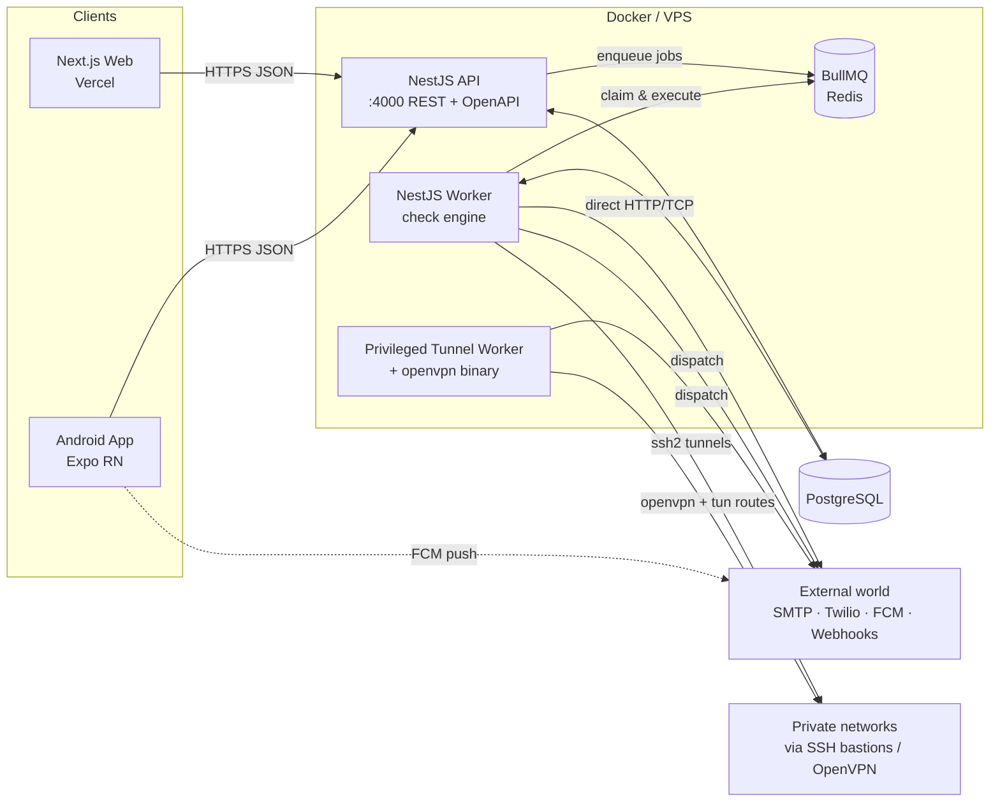
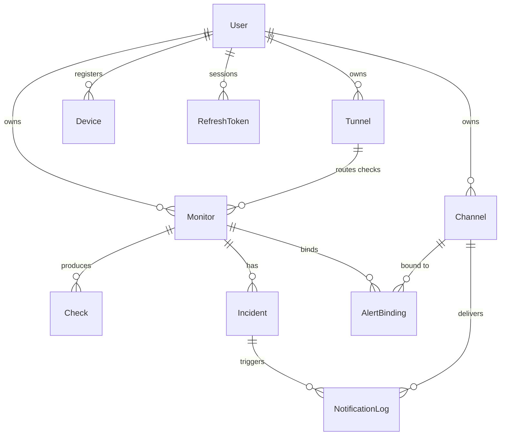

# Upkeep — Engineering & Product Plan

> **Status:** Draft v2 — awaiting approval before implementation (v2 adds signed-URL credential sources)
> **Date:** 2026-11-12
> **Scope:** Full platform — NestJS API, check engine + tunnel workers, Next.js web app, Android-first mobile app, deployment tooling & documentation
> **Guardrails:** Adapted from `GUARDRAILS.md` (Acharya). Turborepo is **not** used — this repo uses **pnpm workspaces**. See Appendix A for the adaptation map.

---

## 1. Product Overview

**Upkeep** is an uptime monitoring and notification platform (comparable to UptimeRobot / Better Uptime) whose differentiator is the ability to monitor **private, internal endpoints** that are unreachable from the public internet. This is achieved through first-class support for:

1. **SSH tunnels** — user-supplied SSH keys, host, port, and remote port-forwarding specs. The platform dials out to the user's bastion/host and checks the target through the forwarded local port.
2. **OpenVPN tunnels** — user-supplied OpenVPN client certificates/configs. The platform establishes a VPN session and checks targets inside the private network.
3. **Bring-your-own credential access** — for users whose compliance standards forbid storing SSH keys or VPN credentials on a third-party server: supply a **signed URL** (AWS S3 presigned URL or GCP Cloud Storage signed URL) instead of uploading the file. Upkeep fetches the credential at runtime, holds it in memory only, and never persists it. AWS and GCP are supported at launch; the provider interface is built for more.

Users register endpoints (HTTP(S) or raw TCP), choose a check interval (30s / 1m / 5m / 10m / 15m / 30m / 1h), and receive alerts through **email, SMS, mobile push notifications, and outbound webhook POSTs** when endpoints go down or recover.

### 1.1 Core User Journeys

| Journey | Description |
|---|---|
| Onboard | Register → verify email → login (web or mobile) |
| Monitor public endpoint | Add monitor (URL or host:port, interval, validation rules) → live status within one interval |
| Monitor private endpoint | Add tunnel (SSH key or OpenVPN config) → attach monitor to tunnel → checks route through the tunnel |
| Get alerted | Configure channels (email / SMS / webhook / push) → bind to monitors with down/recovery rules + cooldowns |
| Diagnose | Inspect uptime %, response-time charts, per-check logs, incident timeline |

### 1.2 Success Criteria (v1)

- Checks for public endpoints run on schedule with ±2s accuracy at the 30s interval under moderate load (500 monitors / single worker).
- SSH-tunneled checks work end-to-end: encrypted key upload → tunnel established → check routed through it — and the same journey works via a signed-URL credential (AWS/GCP) with **zero credential bytes persisted** by Upkeep.
- OpenVPN checks work in the privileged worker deployment (documented, reproducible via `docker compose`).
- Down/up transitions produce incidents and dispatch notifications across all four channels with deduplication and cooldowns.
- Web dashboard + Android app cover the full journey; push notifications arrive on Android.
- Everything deploys via multi-stage Docker images (dist-only) + docs; web deployable to Vercel.

---

## 2. Scope

### 2.1 In Scope — v1

- Auth: email/password registration, login, JWT access + refresh tokens (web cookie / mobile bearer), logout, argon2 hashing.
- Monitors: HTTP(S) checks (method, headers, body, keyword assertion, expected status codes, timeout, redirect policy) and TCP port checks. Interval options: 30s, 1m, 5m, 10m, 15m, 30m, 1h.
- Check engine: scheduled execution, timeout enforcement, state machine with configurable failure/recovery confirmation thresholds (anti-flapping), incident creation/resolution.
- Tunnels: SSH (key-based) and OpenVPN (certificate/config-based) with **two credential modes** — encrypted-at-rest upload, or runtime fetch from customer-generated signed URLs (AWS S3 presigned, GCP Cloud Storage v4) for zero-persistence compliance — plus a tunnel manager (pool, leases, reconnect) and credential-expiry monitoring.
- Notifications: email (SMTP), SMS (Twilio), webhook POST (HMAC-signed), mobile push (FCM); per-monitor bindings, cooldowns, delivery log.
- History & stats: per-check log, uptime %, response-time aggregates with retention policy.
- Web app: landing, auth, dashboard, monitor CRUD + detail (charts, logs, incidents), tunnel management, channel management, incidents page, settings, light/dark theme.
- Mobile app (Android first): login, dashboard, monitor detail, add/edit monitor, incidents, channels, push notifications, deep links.
- Ops: health probes, structured JSON logs with request IDs, metrics endpoint, OpenAPI spec.
- Deployment: Dockerfiles (multi-stage, dist-only), docker-compose (dev + prod single-host), CI (GitHub Actions), migration/seeding as explicit pipeline steps, deployment docs.

### 2.2 Deferred (post-v1)

- Public shareable status pages, maintenance windows, scheduled pauses per calendar.
- ICMP ping monitors (needs raw socket privileges — will piggyback on the privileged worker image later).
- SSL certificate expiry monitoring, domain expiry checks.
- Multi-region checking locations, cron-job monitors (assert a heartbeat arrives on schedule).
- SSO/OAuth login, teams/organizations with role-based access, audit log UI.
- iOS polish + App Store release, background sync widgets.
- Realtime updates over WebSocket/SSE (v1 uses polling with TanStack Query).
- Additional remote-credential providers beyond AWS/GCP signed URLs (Azure Blob SAS, HashiCorp Vault, cloud-KMS-issued short-lived certificates) — interface already shaped for them.

---

## 3. Technology Decisions

| Layer | Choice | Rationale |
|---|---|---|
| Language | TypeScript (strict) everywhere; no Python | Mandated preference; single language across API, web, mobile, shared packages |
| Monorepo | **pnpm workspaces** (no Turborepo) | Mandated. Orchestration via `pnpm -r` scripts + GitHub Actions matrix |
| Backend | **NestJS 11** (Fastify adapter) | Mandated preference. Modular DI architecture maps cleanly to guardrails' 3-tier layering |
| Database | **PostgreSQL 16** | Relational integrity (user→monitor→check→incident→notification), transactions, mature time-series handling via partitioning. Preferred over Mongo for this schema |
| ORM / Migrations | **Prisma** | Production-grade versioned migrations, typed client, first-class NestJS integration |
| Queue / Scheduler | **BullMQ + Redis 7** | Decouples check execution from HTTP serving; retries, concurrency control, horizontal worker scaling |
| Validation | **Zod** at every I/O boundary | Guardrails mandate; schemas shared into `@upkeep/core` for frontend + mobile reuse |
| Auth | JWT (access 15m / refresh 30d rotatable) + argon2 | Cookie-based for web (`httpOnly`), bearer for mobile; refresh rotation with reuse detection |
| SSH tunnels | `ssh2` (Node) | Pure-JS SSH client with local port forwarding; runs unprivileged |
| OpenVPN | `openvpn` binary managed via management socket | Standard approach; requires privileged worker container (NET_ADMIN + `/dev/net/tun`) |
| Remote credentials | `RemoteCredentialProvider` interface: `aws-s3-presigned`, `gcp-signed-url` (v1) | HTTPS fetch with SSRF/size/timeout guardrails, content validation, expiry parsing; material kept in memory only |
| Email | `nodemailer` (SMTP, config-driven) | Provider-agnostic; swap to Resend/SES later without interface change |
| SMS | Twilio REST API behind a provider interface | Most common; interface keeps it swappable |
| Push | FCM via `firebase-admin` (works for Android; APNs later) |expo-notifications on the client side |
| Web | **Next.js (App Router)** + TanStack Query + Zustand | Mandated ("best for Vercel"). Headless-API consumer only — no backend logic |
| Web styling | **CSS Modules + global design-token stylesheet (CSS custom properties)** | Mandated: no inline CSS; token-driven theming (light/dark), maximum extensibility |
| Charts | Custom SVG components (uptime bars, response-time area) | Tiny bundle, full styling control via CSS classes, no inline-style chart libs |
| Icons | `lucide-react` (web) / `lucide-react-native` (mobile) | Consistent, professional, tree-shakeable |
| Mobile | **Expo (React Native, TypeScript)** + expo-router | Mandated preference (TS). Complex functionality (push, deep links, background fetch) supported; shares `@upkeep/api-client` + `@upkeep/core` with web |
| Logging | Pino (`nest-pino`) | Guardrails mandate: structured JSON, request correlation |
| API docs | `@nestjs/swagger` → OpenAPI 3.1 spec at `/docs` | Contract for web/mobile clients |
| Testing | Vitest + Supertest (API), Vitest (packages), Playwright (web e2e smoke) | Fast, strict-TS friendly |
| Runtimes | Node 22 LTS (pinned engines), pnpm ≥ 9 | Guardrails mandate: explicit engine pinning |

---

## 4. Repository Structure (pnpm Workspaces)

```
upkeep/
├── PLAN.md                     # This document (root exception, alongside README + GUARDRAILS)
├── GUARDRAILS.md               # Source guardrails (reference)
├── README.md                   # Project overview + quickstart
├── package.json                # Root: workspaces + dev tooling ONLY (zero runtime deps)
├── pnpm-workspace.yaml
├── .npmrc                      # pnpm settings (strict-peer-dependencies etc.)
├── .gitignore / .dockerignore / .prettierrc / eslint.config.mjs
├── .github/workflows/          # ci.yml, docker.yml (typecheck/lint/test/build gates)
│
├── apps/
│   ├── api/                    # NestJS: headless REST API (JSON only, never serves UI)
│   │   ├── src/
│   │   │   ├── main.ts         # HTTP entry  → dist/main.js
│   │   │   ├── worker.ts       # Check-engine/tunnel worker entry → dist/worker.js
│   │   │   ├── config/         # Zod-validated env boot guard (fail-fast)
│   │   │   ├── common/         # Pipes (Zod), interceptors (response envelope), filters, guards, decorators
│   │   │   ├── modules/
│   │   │   │   ├── auth/       # controller, service, strategies, refresh-token repo
│   │   │   │   ├── users/
│   │   │   │   ├── monitors/   # controller, service, repository
│   │   │   │   ├── tunnels/    # CRUD + credential encryption service
│   │   │   │   ├── checks/     # history + stats queries
│   │   │   │   ├── incidents/
│   │   │   │   ├── channels/   # notification channel CRUD + verification
│   │   │   │   ├── devices/    # mobile push-token registration
│   │   │   │   └── health/     # /health/live, /health/ready
│   │   │   ├── worker/         # Dispatcher loop, check executor, state machine,
│   │   │   │                   # tunnel managers (ssh/, openvpn/), aggregation & retention jobs
│   │   │   └── shared/         # AppError classes, crypto (AES-256-GCM), pagination helpers
│   │   ├── prisma/             # Local references; schema lives in packages/db
│   │   ├── test/               # Supertest e2e
│   │   ├── tsup.config.ts      # Bundles @upkeep/* packages INTO dist (dist-only mandate)
│   │   ├── Dockerfile          # Multi-stage; one image, CMD api | worker
│   │   └── package.json
│   │
│   ├── web/                    # Next.js (App Router) — deployable to Vercel standalone
│   │   ├── public/             # SVG logos, favicons ONLY
│   │   ├── src/
│   │   │   ├── app/            # Routes: (marketing), (auth), (dashboard) groups
│   │   │   ├── components/     # ui/ primitives, charts/, monitors/, layout/
│   │   │   ├── styles/         # tokens.css (design tokens + themes), global.css
│   │   │   ├── lib/            # api client wiring, auth helpers, formatting utils
│   │   │   ├── hooks/          # TanStack Query hooks (monitors, incidents, channels…)
│   │   │   └── stores/         # Zustand (session, UI prefs)
│   │   ├── next.config.ts      # transpilePackages: [@upkeep/core, @upkeep/api-client], output: standalone
│   │   ├── Dockerfile
│   │   └── package.json
│   │
│   └── mobile/                 # Expo React Native (Android first)
│       ├── app/                # expo-router routes (auth, tabs: dashboard/incidents/settings)
│       ├── src/
│       │   ├── components/     # Reusable RN components (mirror web design tokens)
│       │   ├── hooks/          # TanStack Query hooks (shared patterns)
│       │   ├── lib/            # api client, push registration, deep links
│       │   ├── theme/          # Token-based theme mirroring web tokens.css
│       │   └── stores/
│       ├── app.json / eas.json # EAS build config (Android APK/AAB)
│       └── package.json
│
├── packages/
│   ├── core/                   # Pure TS: zero Node/DOM deps
│   │   └── src/
│   │       ├── types/          # Domain types (Monitor, Check, Incident, Channel…)
│   │       ├── schemas/        # Zod schemas (DTO single source of truth) + inferred types
│   │       ├── constants/      # Interval options, enums, limits
│   │       └── logic/          # State-machine transitions, uptime math, cooldown evaluation
│   ├── db/                     # Prisma schema, migrations, seeds, client export
│   │   └── src/
│   │       ├── schema.prisma
│   │       ├── migrations/     # Versioned, immutable once committed
│   │       ├── seeds/          # Idempotent dev seeds
│   │       └── client.ts
│   └── api-client/             # Typed fetch client consumed by web + mobile
│       └── src/                # Endpoints mirror OpenAPI; Zod-parsed responses
│
└── docs/
    ├── README.md               # Documentation index
    ├── architecture/
    │   ├── system-design.md    # This plan distilled + C4 views
    │   ├── check-engine.md     # Scheduler, state machine, tunnel managers
    │   └── adr/                # Decision records (pnpm, Postgres, BullMQ, Expo…)
    ├── deployment/
    │   ├── DEPLOYMENT.md       # Compose single-host + VPS + Vercel topologies
    │   ├── ENVIRONMENT.md      # Full env-var specification table
    │   ├── OPENVPN-WORKER.md   # Privileged worker setup (NET_ADMIN, tun)
    │   └── RUNBOOK.md          # Migrations, backups, scaling, incident ops
    └── requirement/
        └── PRODUCT-SPEC.md     # Feature spec, UX flows, acceptance checklists
```

**Boundary rules** (enforced in review + CI):
- Root contains **zero source code, zero runtime dependencies** — only workspace config, lint/format config, CI, README, PLAN.md, GUARDRAILS.md.
- `apps/api` never serves HTML/CSS/JS statics. `apps/web` never talks to the database directly.
- `packages/core` imports no framework code (no Nest/React/Node APIs).
- All docs live under `docs/` — no loose markdown anywhere else.

---

## 5. System Architecture



### 5.1 Components

| Component | Responsibility | Notes |
|---|---|---|
| **API** (`apps/api`, `main.ts`) | Auth, CRUD, history/stats queries, channel verification, health | Stateless → scale horizontally behind reverse proxy |
| **Worker** (`apps/api`, `worker.ts`) | Dispatcher loop, check executor, state machine, SSH tunnel manager, remote-credential fetcher, notification dispatch, aggregation/retention jobs | Same image as API, different entrypoint. Scales horizontally |
| **Privileged tunnel worker** | Same worker + `openvpn`, `iproute2`; NET_ADMIN + tun | Only needed when OpenVPN monitors exist; SSH-only deployments skip it |
| **Redis** | BullMQ queues + tunnel-ownership leases + rate-limit counters | Single instance v1; managed Redis in prod |
| **PostgreSQL** | All persistent state | Prisma migrations; checks table partitioned by month |
| **Web** | UI only; stateless static + SSR-lite | Vercel (standalone output) or any Node host/container |
| **Mobile** | Native UX, push, deep links | Consumes same REST API |

### 5.2 Queue Topology (BullMQ)

| Queue | Producer | Consumer | Jobs |
|---|---|---|---|
| `checks` | API (immediate "test now"), dispatcher | worker | execute one check round for a monitor |
| `notifications` | state machine on transitions | worker | render + dispatch to one channel |
| `maintenance` | repeatable cron | worker | hourly aggregation rollup, daily retention purge, expired-token cleanup |

Dispatcher design: a ticker in each worker instance runs every **5 seconds**, claims due monitors atomically (`UPDATE monitors SET next_check_at = now() + interval WHERE id IN (…due…) RETURNING *` — row-level claim, safe with N workers), and enqueues one `checks` job per monitor with a dedupe job ID (`check:{monitorId}:{dueAtBucket}`). This keeps 30s-interval accuracy within ±2s without per-monitor timers.

---

## 6. Data Model (PostgreSQL / Prisma)



| Entity | Key fields (abridged) | Notes |
|---|---|---|
| `User` | id (uuid), email (unique), passwordHash, name, role (USER/ADMIN), emailVerifiedAt | argon2id hash |
| `Tunnel` | id, userId, name, type (SSH / OPENVPN), credentialSource (INLINE / SIGNED_URL), credentialProvider (AWS_S3 / GCP_CS, null when INLINE), configCipher (AES-256-GCM blob: inline material **or** the signed URL — both are secrets), credentialExpiresAt (parsed from URL signature, null when INLINE/unknown), fingerprint (sha256 of canonical config for dedupe), status (…/EXPIRED), lastErrorAt | Secrets **never** stored or logged in plaintext; SIGNED_URL mode stores a pointer only, never material |
| `Monitor` | id, userId, tunnelId?, name, type (HTTP/TCP), target (url or host), port?, method?, headers?, body?, keyword?, expectedStatusCodes?, intervalSeconds (enum), timeoutMs, failureThreshold (default 2), recoveryThreshold (default 2), enabled, status (PENDING/UP/DOWN/PAUSED), consecutiveFailures, consecutiveSuccesses, lastCheckedAt, nextCheckAt | `nextCheckAt` is the dispatcher's claim index |
| `Check` | id (bigserial), monitorId, status (UP/DOWN), responseTimeMs, statusCode?, error?, checkedAt | **Range-partitioned by checkedAt (monthly)**; retention 45d raw |
| `CheckAggregate` | monitorId, bucketStart (hour), total, failed, minMs, maxMs, sumMs | Rolled up hourly; powers 7d/30d/90d views; retained 2y |
| `Incident` | id, monitorId, startedAt, resolvedAt?, cause, lastError, durationMs? | One open incident per monitor max |
| `Channel` | id, userId, type (EMAIL/SMS/WEBHOOK/PUSH), label, config (JSON; secrets encrypted), verifiedAt | Webhook config includes optional secret for HMAC |
| `AlertBinding` | id, monitorId, channelId, notifyOnDown, notifyOnRecovery, cooldownMinutes (default 5) | Unique (monitorId, channelId) |
| `NotificationLog` | id, incidentId, channelId, type, event (DOWN/RECOVERY/TEST), status (SENT/FAILED/SKIPPED), error?, createdAt | Auditable delivery history |
| `Device` | id, userId, platform (ANDROID/IOS), pushToken (unique), appVersion, lastSeenAt | FCM tokens |
| `RefreshToken` | id, userId, tokenHash, familyId, expiresAt, revokedAt?, deviceId? | Rotation + reuse detection revokes family |

### 6.1 Volume & Retention

- Worst case per 30s monitor: 2,880 checks/day. 1,000 such monitors ≈ 2.9M rows/day — partitioning + BRIN index on `checkedAt` keeps queries fast; monthly partition detach + drop is the purge mechanism (daily `maintenance` job).
- Stats endpoints read `CheckAggregate` for windows > 24h; raw `Check` only for the last 24h detail view.

---

## 7. Check Engine & Scheduling

### 7.1 Check Execution Flow

```
claim due monitor → resolve route:
  ├── direct        → fetch/axios (HTTP) with AbortController timeout, or net.connect (TCP)
  ├── ssh tunnel    → TunnelManager.ensure(tunnelId) → local port → check via 127.0.0.1:port
  └── openvpn       → VpnManager.ensure(tunnelId) → check via tun-routed target
→ record Check (status, responseTimeMs, statusCode, error)
→ advance state machine → persist monitor counters/status
→ on transition → open/resolve Incident → enqueue notifications
→ schedule nextCheckAt = now + interval
```

### 7.2 State Machine (anti-flapping)

| From | Event | Condition | To | Side effects |
|---|---|---|---|---|
| PENDING | check ok | — | UP | none |
| PENDING | check fail | failures ≥ failureThreshold | DOWN | open incident, notify DOWN |
| UP | check fail | failures ≥ failureThreshold | DOWN | open incident, notify DOWN |
| DOWN | check ok | successes ≥ recoveryThreshold | UP | resolve incident, notify RECOVERY |
| UP/DOWN | check fail/ok | below threshold | unchanged | counters only |
| any | paused | — | PAUSED | resolve open incident (marked "paused", no recovery spam) |

HTTP verdict: down on network error, timeout, TLS failure, or status ∉ expected (default 200–299); keyword assertion failure counts as down. All thresholds and expectations live in `@upkeep/core/logic` as pure functions — unit-tested in isolation.

### 7.3 Concurrency & Limits

- Worker check concurrency: configurable (default 50 parallel checks; per-job timeout = monitor timeout + 5s hard cap).
- Per-user limits (v1 defaults, env-tunable): 50 monitors, 5 tunnels, 10 channels.
- Global outbound rate guard to a single target host (prevent accidental DoS of fragile internal services): token bucket per target, max 1 in-flight check per monitor.

---

## 8. Tunnel Subsystem (The Differentiator)

### 8.1 Credential Sources & Handling

Two credential modes, chosen per tunnel. Both work identically with the tunnel managers (§8.2/§8.3); the mode only changes **where the key material comes from**.

| Mode | What the user provides | What Upkeep stores | Where material lives |
|---|---|---|---|
| **INLINE** (default) | SSH private key or OpenVPN config, pasted or uploaded | AES-256-GCM-encrypted material (`configCipher`, `ENCRYPTION_KEY` from env — KMS/Vault-recommended in prod) | Worker memory during use |
| **SIGNED_URL** | Time-limited signed URL to the credential file — AWS S3 presigned GET URL or GCP Cloud Storage signed URL (v4) | AES-256-GCM-encrypted URL (the URL carries auth query params — it is itself a secret) | **Nowhere on disk** — fetched at (re)connect, worker memory only |

**Why SIGNED_URL exists:** compliance regimes that forbid a third-party server persisting SSH keys / VPN credentials. In this mode Upkeep never writes fetched material to the database or filesystem (OpenVPN's tmpfs config file is memory-backed and wiped — §8.3); the blob in `configCipher` is only the URL pointer.

#### Remote credential fetch pipeline (worker)

```
resolve tunnel source → provider = AWS_S3 | GCP_CS
→ guardrails: HTTPS-only · optional host allowlist · 256 KB size cap · 10 s timeout
→ GET url (no redirects into private ranges — SSRF guard)
→ validate content: must parse as OpenSSH/PEM private key or OpenVPN config
→ parse expiry from signature params (X-Amz-Date/X-Amz-Expires · X-Goog-Date/X-Goog-Expires)
→ hand material to tunnel manager · zero buffers after use · never logged
```

- **Provider interface** (`RemoteCredentialProvider`: `fetch()`, `parseExpiry()`, `label`) keeps Azure Blob SAS, HashiCorp Vault, or KMS-issued short-lived certs as drop-in additions — no call-site changes.
- **Expiry lifecycle:** `credentialExpiresAt` is parsed at save time and surfaced in web/mobile with a countdown badge. Warning (default T-3 days) and "expired" alerts flow through the standard notification subsystem (§9); an expired tunnel enters `EXPIRED` state with clear diagnostics.
- **Rotation without rebuild:** `PATCH /v1/tunnels/:id` accepts a fresh signed URL; live tunnels hot-swap the source on next reconnect and monitors keep running.
- **Write-only secrets in both modes:** GET endpoints return metadata only (mode, provider, fingerprint, expiry, status) — credential bytes and URLs never leave the API.
- `POST /v1/tunnels/:id/test` validates the source end-to-end (fetch + parse + connectivity probe) for both modes and returns sanitized diagnostics — no key material in responses.

### 8.2 SSH Tunnel Manager (`ssh2`)

- Pool keyed by `tunnelId` → `{ sshConnection, localPort, lastUsedAt, state }`.
- Local port allocation from an ephemeral tracked range (20000–40000); released after idle TTL (default 120s) so frequent monitors keep tunnels warm and occasional ones don't leak ports.
- Keepalives (server-side interval requests), automatic reconnect with exponential backoff, hard max age to force periodic rekey.
- **Ownership across workers:** Redis lease (`SET tunnel:{id}:owner workerId NX EX 30`, heartbeat renewal) guarantees exactly one worker holds a given tunnel; the dispatcher prefers routing monitors to the owner worker via queue sharding (BullMQ `grouping` by tunnelId). If the lease is lost, tunnels drain and re-establish elsewhere.

### 8.3 OpenVPN Manager (privileged worker)

- Per tunnel: materialize the credential (decrypted INLINE material or freshly fetched SIGNED_URL material) to a `tmpfs` file (0600, memory-backed, wiped after start), spawn `openvpn --config … --management 127.0.0.1:{mgmtPort} --route-nopull --dev tun`, track state via the management socket.
- **Routing without hijacking the default route:** `--route-nopull` + explicit `ip route replace {targetIp}/32 dev tunX metric 1` per monitored target (resolved host IPs, refreshed on check). Checks for those targets then flow through the VPN while all other traffic (DB, Redis, SMTP…) stays on the primary interface.
- Requires image with `openvpn`, `iproute2`; container needs `cap_add: [NET_ADMIN]` and `/dev/net/tun`. Fully documented in `docs/deployment/OPENVPN-WORKER.md` with a compose profile (`--profile openvpn`).
- Known v1 limitation (documented): two simultaneous VPNs routing the **same overlapping target subnet** conflict — v1.5 fix is per-tunnel network namespaces (`ip netns`) with checks executed through `nsenter`; schema and manager interface are designed to absorb that change.

---

## 9. Notification Subsystem

### 9.1 Channels & Providers

| Type | Provider (v1) | Config fields | Delivery |
|---|---|---|---|
| EMAIL | nodemailer over SMTP (env-configured) | to, (per-user default email) | Templated HTML + text; up/down/recovery subjects |
| SMS | Twilio | to (E.164) | Concise plain text |
| WEBHOOK | outbound HTTPS POST | url, secret? | JSON payload + `X-Upkeep-Signature` (HMAC-SHA256, timestamped); 3 retries, exp backoff, 10s timeout |
| PUSH | FCM (firebase-admin) | per-device tokens | Title/body + deep link (`upkeep://monitor/{id}`, `upkeep://incident/{id}`) |

All providers sit behind a `NotificationProvider` interface registered in Nest DI — adding SendGrid/SES/MessageBird later is a new class, zero call-site changes.

### 9.2 Dispatch Rules

- On incident open → for each binding with `notifyOnDown`: if last sent for (monitor, channel, event) within `cooldownMinutes` → skip (logged SKIPPED); else enqueue.
- On recovery → same with `notifyOnRecovery` (independent cooldown bucket).
- Every attempt recorded in `NotificationLog` (status, error, latency) — visible per incident in the UI ("who was told, when").
- `POST /v1/channels/:id/verify` sends a test message so users validate config before relying on it.
- System events ride the same machinery: tunnel credential expiring/expired (§8.1) and tunnel-connectivity failures notify through the user's channels with the same cooldown/dedup rules.

---

## 10. API Specification (REST, `/v1`)

Envelope per guardrails: `{ success, data, meta? }` / `{ success: false, error: { code, message, details?, requestId } }`. Zod DTOs for every body/query/param; OpenAPI generated from the same schemas. Auth = JWT bearer (mobile) or `httpOnly` cookie (web, `sameSite=lax`, `secure` in prod).

| Area | Endpoints |
|---|---|
| Auth | `POST /v1/auth/register` · `POST /v1/auth/login` · `POST /v1/auth/refresh` · `POST /v1/auth/logout` · `GET /v1/auth/me` |
| Monitors | `GET/POST /v1/monitors` · `GET/PATCH/DELETE /v1/monitors/:id` · `POST /v1/monitors/:id/pause` · `POST /v1/monitors/:id/resume` · `POST /v1/monitors/:id/test` · `GET /v1/monitors/:id/checks` · `GET /v1/monitors/:id/stats?window=24h\|7d\|30d\|90d` |
| Tunnels | `GET/POST /v1/tunnels` (DTO is a discriminated union: `inline` material **or** `signed-url` {provider, url}) · `PATCH/DELETE /v1/tunnels/:id` (PATCH rotates the signed URL without rebuilding) · `POST /v1/tunnels/:id/test` (source validation + connectivity probe) |
| Channels | `GET/POST /v1/channels` · `PATCH/DELETE /v1/channels/:id` · `POST /v1/channels/:id/verify` |
| Incidents | `GET /v1/incidents` · `GET /v1/incidents/:id` |
| Dashboard | `GET /v1/summary` (counts by status, uptime leaderboard, recent incidents) |
| Devices | `POST /v1/devices` · `DELETE /v1/devices/:id` (mobile push registration) |
| Ops | `GET /health/live` · `GET /health/ready` (DB + Redis probe) · `GET /docs` (OpenAPI UI, non-prod) |

Rate limits: auth endpoints 10 req/min/IP; API default 120 req/min/user; `test` endpoints 6/min/user.

---

## 11. Web Frontend (Next.js)

### 11.1 Information Architecture

```
/                      Landing (marketing, public)
/login  /register      Auth (cookie session)
/dashboard             Monitors overview: status tiles (up/down/paused), monitor table,
                       filters (status/type/tunnel), quick pause/resume, "test now"
/dashboard/monitors/new   Wizard: type → target → interval → validation → tunnel → alerts
/dashboard/monitors/:id   Detail: status header, 90-day uptime bar chart, response-time
                          graph (1h/24h/7d/30d), recent checks table, incident timeline,
                          notification history, settings/edit
/dashboard/tunnels     Tunnel list + create/edit (SSH & OpenVPN forms; credential-source picker:
                       upload/paste vs signed URL with AWS/GCP helper links), status +
                       expiry badge, test
/dashboard/channels    Channel list + create/edit (email/SMS/webhook), verify (test send)
/dashboard/incidents   Filterable incident history with duration + notification log
/dashboard/settings    Profile, password, theme, session management
```

### 11.2 Technical Approach

- **Rendering:** Server Components for shells/layout; client components for interactive dashboard (TanStack Query with 10–30s smart refetch intervals replace v1 realtime).
- **State:** TanStack Query (server state) + tiny Zustand stores (auth session hydration, theme, table prefs).
- **API client:** `@upkeep/api-client` — shared fetch wrapper with auth token handling, Zod response parsing, typed errors. No direct `fetch` in components.
- **Independence:** Web is a pure API consumer (`NEXT_PUBLIC_API_URL`); it can be deployed, re-skinned, or replaced without touching the backend.
- **Styling:** see §12 — CSS Modules + token stylesheet; **zero inline `style=` attributes in JSX**.

---

## 12. Design System & UI Standards

### 12.1 Principles

Professional SaaS monitoring aesthetic: calm neutral surfaces, one strong accent, status colors that carry meaning (green up / red down / amber degraded / gray paused), generous whitespace, tabular numerals for metrics, dense-but-legible data tables.

### 12.2 Design Tokens (`apps/web/src/styles/tokens.css`)

- **Color (light):** primary `#4F46E5` (indigo 600) + hover/active ramp; success `#16A34A`; danger `#DC2626`; warning `#D97706`; neutral 12-step gray ramp; semantic tokens (`--color-surface`, `--color-border`, `--color-text-primary`…) reference ramp values — components only ever use semantic tokens.
- **Dark theme:** same token names remapped under `[data-theme="dark"]`; default follows `prefers-color-scheme`.
- **Type:** Inter (variable, self-hosted via `next/font`); scale 12/13/14/16/18/20/24/30/36; `font-variant-numeric: tabular-nums` on metric fields.
- **Spacing:** 4px base scale (4/8/12/16/24/32/48/64). **Radii:** 4/8/12. **Shadows:** 3 elevations + focus ring. **Z-index scale** and **motion durations** tokenized.
- Mobile theme (`apps/mobile/src/theme/`) mirrors the same values as TS constants — one visual language across platforms.

### 12.3 Component Library (web `components/ui/`)

Button, IconButton, Input, Select, Textarea, Switch, Badge, StatusDot, Card, StatCard, Table (sortable, empty/loading states), Modal, Drawer, Tabs, Toast, Tooltip, Skeleton, EmptyState, ConfirmDialog, Pagination — plus domain components: UptimeBars (90×day bars), ResponseChart (SVG area), IncidentTimeline, MonitorForm, TunnelForm, ChannelForm.

### 12.4 CSS Rules (enforced by review + lint)

1. **No inline `style` props** — all styling via CSS Modules (`.module.css`) or token classes; dynamic values (e.g., chart bar heights) set via CSS custom properties on the element's `style` attribute only where a value is genuinely data-driven (charts) — documented exception.
2. One CSS Module per component; class names BEM-ish (`.monitorCard__header--muted`).
3. Only semantic tokens inside component CSS — no raw hex/px outside `tokens.css`.
4. Responsive breakpoints: 640 / 768 / 1024 / 1280; mobile-first; dashboard usable at phone width.
5. Accessibility: WCAG AA contrast, visible focus rings, keyboard-navigable tables/modals, `aria-live` toasts, status conveyed by color **and** icon/text.

---

## 13. Mobile App (Android-first, Expo)

### 13.1 Screens (expo-router)

```
app/
├── (auth)/login.tsx, register.tsx
├── (tabs)/
│   ├── index.tsx        Dashboard: status summary, monitor list, pull-to-refresh
│   ├── incidents.tsx    Incident history with filters
│   └── settings.tsx     Theme, account, channel shortcuts
├── monitor/[id].tsx     Detail: uptime bars, response chart, checks, incidents
├── monitor/new.tsx      Add/edit monitor (tunnel picker included)
└── tunnel/*, channel/*  Manage tunnels (both credential modes) & channels
```

### 13.2 Platform Capabilities

- **Push:** `expo-notifications` → FCM; token registered via `POST /v1/devices`; payloads deep-link (`upkeep://` + https app links) straight to the incident/monitor.
- **Data:** same `@upkeep/api-client` (react-native polyfills for fetch/URL) + TanStack Query; bearer token in `expo-secure-store`.
- **UX:** light/dark follows OS (token theme), haptic feedback on status changes, offline-friendly cached views with "last updated" indicator.
- **Background:** v1 relies on push (FCM) for timely alerts — no battery-draining background polling; optional background fetch refresh in v1.5.
- **Builds:** EAS Build → Android APK (dev/QA) + AAB (Play Store); `eas.json` profiles in repo; iOS deferred.

---

## 14. Security & Hardening

- **Boot guard:** Zod-validated `config/env.ts` — process refuses to start on missing/weak vars (SESSION/JWT secrets ≥ 32 chars, ENCRYPTION_KEY exactly 32 bytes, DATABASE_URL/REDIS_URL present, CORS_ORIGIN set). No `process.env.X || fallback` anywhere.
- **Fail closed:** every non-`@Public` route requires a valid JWT; ownership checks (`monitor.userId === session.userId`) in services, not just controllers. Errors deny, never allow.
- **Headers/CORS:** Helmet defaults + strict CORS allowlist (web origin + capacitor/expo schemes), credentials enabled, methods restricted.
- **Secrets:** tunnel credentials & channel secrets AES-256-GCM encrypted at rest; plaintext only in worker memory; write-only over API; `.env*` git-ignored & docker-ignored; Gitleaks in CI.
- **Remote credential fetch (SIGNED_URL mode):** HTTPS-only, optional host allowlist, 256 KB size cap, 10s timeout, no redirects into private ranges (SSRF guard), parse-before-use content validation; fetched material is memory-only and never logged; the URL itself is encrypted at rest because it carries auth query params.
- **Transport:** TLS terminated at reverse proxy (Caddy — automatic Let's Encrypt) or platform (Vercel); HSTS on.
- **Injection:** Prisma parameterized queries only; webhook URLs validated (scheme https/http, no localhost/private-range SSRF against our own infra — explicit allowlist option); webhook responses never executed.
- **Auth hardening:** refresh-token rotation with family revocation on reuse detection; login throttling per IP+account; argon2id (memory 64MB, time 3).
- **Notification spoofing:** outbound webhooks HMAC-signed so receivers can verify authenticity.

---

## 15. Observability

- **Logs:** Pino JSON, one line per request (`x-request-id` UUID echoed in response header + error envelope), redaction list for auth headers and tunnel config fields.
- **Metrics:** `/metrics` (Prometheus format): checks executed/failed by type, check latency histogram, queue depth/latency, tunnel states, notification delivery outcomes. Alert rules suggested in runbook (e.g., `checks_failed_total` spike, queue depth > 500).
- **Health:** `/health/live` (process up), `/health/ready` (DB + Redis round-trip) — wired to Docker/compose healthchecks and load-balancer probes.
- **Self-monitoring dogfooding:** Upkeep monitors itself in prod (its own `/health/ready` + web URL) — first monitor seeded at deploy.

---

## 16. Testing Strategy

| Level | Tool | Targets | Gate |
|---|---|---|---|
| Unit | Vitest | `@upkeep/core` state machine, uptime math, cooldown logic, Zod schemas, webhook signer | ≥ 85% on core |
| Integration | Vitest + Supertest + Testcontainers (Postgres, Redis) | Auth flows, monitor CRUD, ownership denials, check recording, stats windows | Key flows green |
| Worker | Vitest | Dispatcher claim race (2 workers), SSH manager against a containerized sshd mock, credential-fetch pipeline (mock object-store endpoint: expiry parsing, size cap, invalid-content rejection, SSRF denial), state transitions → incidents → queued notifications | Key flows green |
| Web | Vitest (components/hooks) + Playwright smoke (login → create monitor → see check result) | Critical paths | Smoke green |
| Mobile | Jest/Expo unit for stores/utils; manual QA checklist per release | — | Checklist |

Every bug fix ships with a reproducing regression test (guardrails §10).

---

## 17. Containerization & Deployment

### 17.1 Images (multi-stage, dist-only per guardrails §11)

- **`apps/api`** → `ghcr.io/<org>/upkeep-api` — one image, two roles: `CMD ["node","dist/main.js"]` (API) / `["node","dist/worker.js"]` (worker). `tsup` inlines `@upkeep/core` + `@upkeep/db` into `dist/` → runtime has zero monorepo dependency. Unprivileged user, non-root, healthcheck via `/health/live`.
- **Variant `upkeep-api:openvpn`** — same + `openvpn`, `iproute2`, `tini`; used only for the privileged tunnel worker.
- **`apps/web`** → Next standalone output; Vercel-native (zero config) or `ghcr.io/<org>/upkeep-web` for container deploys.

### 17.2 Topologies

| Scenario | Layout |
|---|---|
| **Dev** | `docker compose -f compose.dev.yml`: postgres, redis, api (tsx watch), web (next dev), adminer; migrations via `pnpm db:migrate` (explicit, never auto) |
| **Single-host prod (VPS)** | `docker compose -f compose.prod.yml`: Caddy (TLS) → api (×2) + worker (×1, SSH profile) + privileged openvpn worker (profile `openvpn`), managed or containerized Postgres + Redis, nightly `pg_dump` cron |
| **Split prod** | Web → **Vercel** (standalone, `NEXT_PUBLIC_API_URL`); API + workers → VPS/Fly/Render containers; Postgres → Neon/RDS; Redis → Upstash/ElastiCache; secrets via platform env/Vault |

### 17.3 CI/CD (GitHub Actions)

- `ci.yml` (PRs): pnpm install (frozen lockfile) → lint → typecheck → unit → integration (services: postgres, redis) → build all → `prisma validate` → Gitleaks → Docker build (no push).
- `docker.yml` (main): build+push multi-arch images (tag = git SHA), deploy hook documented.
- Migrations/seeds are **separate explicit steps** (`pnpm --filter @upkeep/db run migrate:deploy`) run by the deploy pipeline before rollout — never inside app startup or build (guardrails §5.3).

---

## 18. Documentation Plan (deliverables)

| Document | Contents |
|---|---|
| `README.md` | Overview, quickstart (3-command dev), links |
| `docs/README.md` | Doc index |
| `docs/requirement/PRODUCT-SPEC.md` | Features, UX flows, acceptance checklists |
| `docs/architecture/system-design.md` | Distilled architecture + C4 + sequence diagrams (check round, incident, notification) |
| `docs/architecture/check-engine.md` | Scheduler/state machine/tunnel internals |
| `docs/architecture/credential-sources.md` | Credential modes (inline vs signed URL), fetch pipeline, expiry/rotation lifecycle, and how-to-generate guides (`aws s3 presign`, `gcloud storage sign-url`) |
| `docs/architecture/adr/*.md` | ADRs: pnpm over turbo, Postgres over Mongo, BullMQ, Expo, CSS Modules, credential-source model |
| `docs/deployment/DEPLOYMENT.md` | Dev compose → single-host → split (Vercel) topologies, TLS, scaling, upgrade procedure |
| `docs/deployment/ENVIRONMENT.md` | Every env var: name, required?, format, default, secret-class, per-service matrix |
| `docs/deployment/OPENVPN-WORKER.md` | Privileged worker setup, security trade-offs, verification steps |
| `docs/deployment/RUNBOOK.md` | Migrations, backups/restore drills, scaling, common incidents, self-monitoring |

---

## 19. Implementation Roadmap

Each phase ends with everything committed, lint/typecheck/test-clean, and the app runnable.

| # | Phase | Contents | Exit criteria |
|---|---|---|---|
| 0 | **Scaffold** | pnpm workspace, root configs (eslint flat, prettier, gitignore/dockerignore), package skeletons, `compose.dev.yml`, CI skeleton, docs skeleton | `pnpm -r typecheck` green; compose boots empty api + web |
| 1 | **Core packages** | Prisma schema + initial migration + seeds; `@upkeep/core` types/schemas/constants/state-machine logic + unit tests; `@upkeep/api-client` skeleton | Core tests ≥ 85%; `pnpm db:migrate` reproducible |
| 2 | **Auth & users** | Nest bootstrap (Fastify, helmet, CORS, pino, Zod pipes, envelope, error filter), auth module (register/login/refresh/logout/me), guards, health endpoints | Supertest auth suite green; OpenAPI renders |
| 3 | **Monitors + check engine (direct)** | Monitors CRUD + validation; worker entry: dispatcher, executor (HTTP/TCP direct), state machine wiring, incidents, checks history + stats endpoints, `test` action | Monitor created via API shows real checks at chosen interval; incidents open/resolve |
| 4 | **Notifications** | Channels CRUD + verify; providers email (SMTP) + webhook (HMAC); bindings, cooldowns, NotificationLog; `maintenance` queue | Down/up on a monitor sends email + signed webhook |
| 5 | **SSH tunnels + credential sources** | Credential-source abstraction: INLINE (encrypted at rest) **and** SIGNED_URL fetch with AWS/GCP providers, expiry parsing + rotation; tunnels CRUD; SSH manager (pool, leases, reconnect); monitors route via tunnel; `tunnel test` | End-to-end both ways: (a) uploaded key and (b) signed URL → tunnel established → private monitor checks succeed; zero persistence in mode (b) |
| 6 | **Web app** | Design tokens + UI kit; auth pages; dashboard; monitor wizard + detail (charts, logs); incidents; channels; tunnels; settings; themes; Playwright smoke | Full journey usable in browser at phone+desktop widths |
| 7 | **Mobile app** | Expo scaffold, auth, dashboard, monitor detail/add, incidents, channels, push + deep links; EAS profiles | Android build receives push and links to incident |
| 8 | **OpenVPN** | VPN manager (works with both credential modes) + privileged image + routing; docs; compose profile | Private target checked over VPN (inline and signed-URL credential) without breaking worker's other egress |
| 9 | **Hardening & scale** | Aggregation rollup + retention purge; rate limits final; metrics; load test (500 monitors @ 30s); security pass | Load test report; p95 check accuracy within ±2s |
| 10 | **Ship docs** | All docs final; single-host + Vercel split guides verified end-to-end | Fresh-machine deploy follows docs successfully |

Dependency notes: 6 and 7 can proceed in parallel once 3–4 are stable; 8 only blocks OpenVPN users, not the core product.

---

## 20. Risks & Mitigations

| Risk | Impact | Mitigation |
|---|---|---|
| 30s interval load (many monitors) | Dispatcher/queue saturation | Row-claim dispatcher (no per-monitor timers), partitioned checks, concurrency caps, load test in phase 9, worker horizontal scaling |
| SSH library edge cases (ciphers, keepalive drops) | Tunnels silently die | Health heartbeats + auto-reconnect, per-tunnel metrics, `ssh2` battle-tested; integration test against containerized sshd |
| OpenVPN routing complexity | Worker loses DB/Redis connectivity if routes leak | `--route-nopull` + explicit /32 host routes only; smoke check of egress paths after connect; dedicated privileged worker so blast radius excludes API |
| Signed-URL expiry (AWS/GCP cap at 7 days) | Tunnels fail once the URL lapses | Expiry parsed from signature params at save time; `credentialExpiresAt` surfaced with countdown badge; T-3d warning + expired alerts via the notification subsystem; `EXPIRED` tunnel state with clear diagnostics; one-call PATCH rotation |
| Malformed/poisoned remote credential | Tunnel breaks or behaves unexpectedly | Parse-before-use content validation, 256 KB size cap, sanitized `tunnel test` diagnostics, fetched content never executed |
| Notification deliverability (spam filters, Twilio errors) | Missed alerts | Verification sends, provider retries, NotificationLog surfaced in UI, self-monitoring alerts |
| Secrets leakage | Catastrophic | Encrypt-at-rest, write-only APIs, log redaction, Gitleaks, no secrets in images |
| Expo native gaps | Blocked mobile feature | Push/deep-links/secure-store are core Expo capabilities; EAS dev-build escape hatch if a bare module is ever needed |
| Flapping endpoints → alert storms | Trust erosion | Confirmation thresholds + cooldowns + incident-level dedupe by design (§7.2, §9.2) |

---

## 21. Assumptions & Open Questions

**Assumptions** (change any of these and the plan adapts):
1. Postgres chosen over Mongo (relational + retention fit); single primary, read replica optional later.
2. v1 is single-tenant per account (no teams/orgs); schema keeps `userId` on owner entities so orgs can be added later without migration pain.
3. Email via self-configured SMTP (env vars); no provider lock-in.
4. Android first: iOS build config exists but is untested until post-v1.
5. Landing page is a single marketing page, not a docs/marketing site.
6. Remote-credential access launches with AWS S3 presigned URLs and GCP Cloud Storage signed URLs (v4); the provider interface is deliberately narrow (`fetch`, `parseExpiry`, label) so Azure SAS / Vault / KMS-issued certs slot in later without schema changes.

**Open questions** (answer at kickoff; defaults in parentheses):
1. Should check data be retained beyond 45 days raw / 2 years aggregated? (default: no)
2. Are sub-30s intervals ever needed? (default: no — 30s floor, matching your list)
3. Web auth cookie vs bearer for the dashboard? (default: httpOnly cookie)
4. Should webhook payloads be versioned from day 1? (default: yes — `payload.version: 1`)
5. Allow a generic "any HTTPS signed URL" provider, or restrict strictly to AWS/GCP signature formats? (default: restrict — a `GENERIC_HTTPS` provider can be enabled behind an env flag later)
6. Credential-expiry warning threshold? (default: warn at T-3 days and again on expiry)

---

## Appendix A — GUARDRAILS Adaptation Map (Acharya → Upkeep)

| Guardrail | Status here | Notes |
|---|---|---|
| Turborepo workspace | **Replaced** | pnpm workspaces; `pnpm -r` + CI matrix replace `turbo run` |
| Strict TS config (§3) | **Kept verbatim** | Shared base tsconfig in root `tsconfig.base.json` |
| Headless API / no static serving (§6.1) | **Kept** | NestJS serves JSON only; web fully separate |
| Dist-only deployment (§5.4) | **Kept** | `tsup` inlines `@upkeep/*` into `dist/`; Next `output: standalone` |
| 3-tier modules (§6.2) | **Kept** | Nest controller → service → repository(Prisma) |
| Zod at I/O boundaries (§3.2) | **Kept** | Custom ZodValidationPipe instead of class-validator |
| Response envelope (§6.3) | **Kept** | Interceptor + exception filter |
| Env boot guard, fail fast (§7.1) | **Kept** | Zod-validated config module |
| Pino logging + request IDs (§9) | **Kept** | `nest-pino` |
| Health probes (§9.4) | **Kept** | live/ready split |
| Migrations as code, no auto-migrate at boot (§8) | **Kept** | Prisma Migrate as pipeline step |
| Multi-stage Dockerfile + dockerignore (§11) | **Kept** | Per-app Dockerfiles; one API image → api/worker roles |
| Docs taxonomy under `docs/` (§2.1) | **Kept** | architecture / deployment / requirement |
| Lean root, no loose code/docs at root (§2) | **Kept** | Only README, PLAN.md, GUARDRAILS.md + tooling config |
| Husky/lint-staged/commitlint (§4) | **Kept (simplified)** | lint-staged + commitlint; pre-push runs typecheck+test |
| PDF/media quarantine (§5.6) | **N/A** | Not applicable; binary gitignore patterns still enforced |
| Testing pyramid (§10) | **Kept** | Vitest everywhere; Testcontainers for integration |
| CI gates (§12/§13) | **Kept** | lint/typecheck/test/build/gitleaks; PR checklist |

## Appendix B — Environment Variables (preview; full table in `docs/deployment/ENVIRONMENT.md`)

| Var | Service | Required | Notes |
|---|---|---|---|
| `NODE_ENV` | all | yes | development / test / production |
| `PORT` | api | yes (default 4000) | HTTP port |
| `DATABASE_URL` | api, worker | yes | Postgres connection string |
| `REDIS_URL` | api, worker | yes | BullMQ + leases |
| `JWT_ACCESS_SECRET`, `JWT_REFRESH_SECRET` | api, worker | yes | ≥ 32 chars; fail boot otherwise |
| `ENCRYPTION_KEY` | api, worker | yes | 32 bytes base64; tunnel/channel secret encryption |
| `CORS_ORIGIN` | api | yes | Comma list: web origin(s) + mobile scheme |
| `SMTP_HOST/PORT/USER/PASS/FROM` | worker | email feature | SMTP relay for notifications |
| `TWILIO_ACCOUNT_SID/AUTH_TOKEN/FROM` | worker | sms feature | SMS provider |
| `FCM_PROJECT_ID/CLIENT_EMAIL/PRIVATE_KEY` | worker | push feature | firebase-admin service account |
| `CREDENTIAL_FETCH_MAX_BYTES` / `CREDENTIAL_FETCH_TIMEOUT_MS` / `CREDENTIAL_HOST_ALLOWLIST` | worker | no | Signed-URL fetch guardrails (defaults: 262144 / 10000 / provider-default rules) |
| `WORKER_CONCURRENCY` | worker | no (default 50) | Parallel checks |
| `LOG_LEVEL` | all | no (default info) | Pino level |
